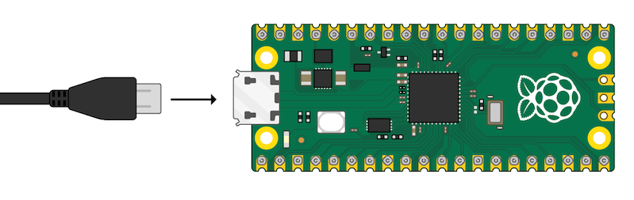
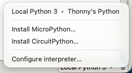
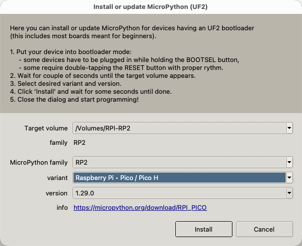
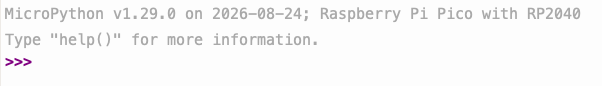
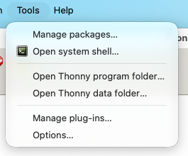
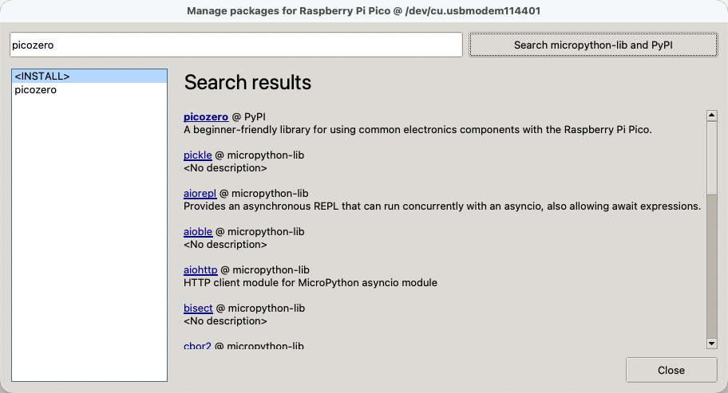
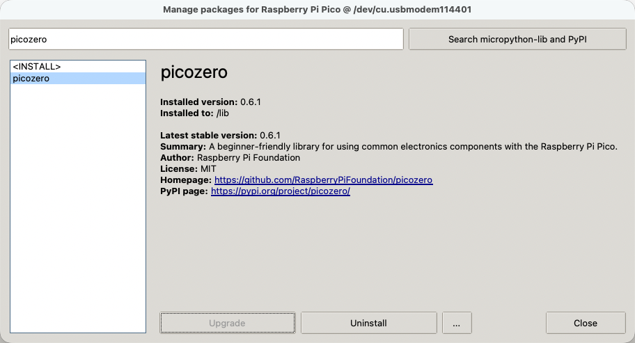
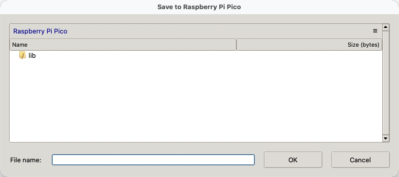

## Set up your Raspberry Pi Pico

Connect your Raspberry Pi Pico and set up MicroPython.

MicroPython is a version of the Python programming language for microcontrollers, such as your Raspberry Pi Pico. MicroPython lets you use your Python knowledge to write code to interact with electronics components.

--- task ---

Connect the small end of your data USB cable to the Raspberry Pi Pico, then open Thonny on your computer.

--- /task ---

The screenshots show Thonny 5 on macOS. Your window may look slightly different on another operating system.

If your Pico already runs MicroPython and Thonny shows a `>>>` prompt when connected to it, skip the firmware installation and continue to the `picozero` instructions below.

--- task ---

To install MicroPython, unplug the Raspberry Pi Pico from your computer. Hold down the **BOOTSEL** button on the Pico while you plug it back in using a **data** USB cable, then release the button.

The Pico appears as a removable drive. On a Raspberry Pi Pico or Pico W, this drive is called **RPI-RP2**.

--- /task ---

--- task ---

In Thonny, click the interpreter selector in the bottom-right corner of the window, then choose **Install MicroPython…**.

If **Install MicroPython…** is not listed, check that the Pico is connected in BOOTSEL mode and that your computer can see its removable drive.

--- /task ---

--- task ---

In the **Install or update MicroPython (UF2)** window:

+ Select the Pico's drive in **Target volume**.
+ Select **RP2** in **MicroPython family**.
+ Choose the **variant** that matches the model printed on your board. For example, choose **Raspberry Pi · Pico / Pico H** for an original Pico, or **Raspberry Pi · Pico W / Pico WH** for a Pico W.
+ Select the latest stable numbered **version**. Avoid preview versions for this project.

Click **Install** and wait for the installation to finish. Keep the Pico connected while the firmware is being written.

--- /task ---

--- task ---

Close the installer when it has finished. The Pico's removable drive disappears as it restarts with MicroPython.

Click the interpreter selector again and choose the **MicroPython (Raspberry Pi Pico)** entry for your connected board. The port name depends on your computer.

If the board is not listed yet, unplug it and reconnect it **without holding BOOTSEL**, then try again. Click the red **Stop/Restart backend** button to reconnect if needed.

The Shell should show a MicroPython message and a `>>>` prompt.

--- /task ---

--- task ---

**Debug:**

--- collapse ---
---
title: The Pico's drive does not appear
---

Unplug the Pico, then hold **BOOTSEL** while reconnecting it. Release the button after connecting.

Use a USB cable that can transfer data. A charging-only cable will power the Pico but will not let your computer communicate with it. Try another data cable or USB port.

If macOS asks Thonny for access to removable volumes, allow access so it can find the Pico's drive.

--- /collapse ---

--- collapse ---
---
title: Firmware installation fails
---

Check your internet connection: Thonny downloads the available firmware versions and the selected firmware.

Check that the selected target volume belongs to your Pico and that the variant matches your board. Reconnect the Pico while holding **BOOTSEL**, then try the installation again.

--- /collapse ---

--- collapse ---
---
title: Firmware is installed but Thonny cannot connect
---

Reconnect the Pico **without holding BOOTSEL**. Choose its **MicroPython (Raspberry Pi Pico)** entry in Thonny's interpreter selector, then click **Stop/Restart backend**.

If needed, choose **Run** > **Configure interpreter…**, select **MicroPython (Raspberry Pi Pico)**, and check the port for your connected board. Close any other program that might be using that port.

Check your data USB cable and try another USB port before reinstalling firmware.

--- /collapse ---

--- /task ---

`picozero` is a MicroPython library for beginners to the Raspberry Pi Pico.

--- task ---

Check that Thonny is connected to your Pico: the interpreter selector at the bottom-right should show **MicroPython (Raspberry Pi Pico)**.

Choose **Tools** > **Manage packages…**. The window title should say **Manage packages for Raspberry Pi Pico**, so the library will be installed on your board.

--- /task ---

--- task ---

Type `picozero` in the search box and click **Search micropython-lib and PyPI**.

--- /task ---

--- task ---

Select **picozero @ PyPI** in the search results, then click **Install**. If an older version is already installed, click **Upgrade** instead. If the installed version matches the latest stable version, you can continue.

Wait for the installation to finish. The package information will show the installed version and its location on the Pico, `/lib`.

Close the package manager, then click the red **Stop/Restart backend** button in Thonny before running your code.

--- /task ---

If you have difficulties installing the `picozero` library in Thonny, you can download the library file and save it to your Raspberry Pi Pico.

--- collapse ---
---
title: Install picozero without the package manager
---

On a computer with internet access, open the [picozero library file](https://raw.githubusercontent.com/RaspberryPiFoundation/picozero/master/picozero/picozero.py){:target="_blank"} and save it as `picozero.py`. If needed, transfer the file to your programming computer using a USB drive.

Connect the Pico and select its **MicroPython (Raspberry Pi Pico)** interpreter in Thonny.

Choose **File** > **Open…**, then **This computer**, and open the downloaded `picozero.py` file. Choose **File** > **Save as…**, then **Raspberry Pi Pico**. In the Pico's top-level folder, enter `picozero.py` in **File name** and click **OK**.

Click **Stop/Restart backend** before running your project code. Keep your own project in a separate file, such as `firefly.py` or `pico_led.py`.

--- /collapse ---
