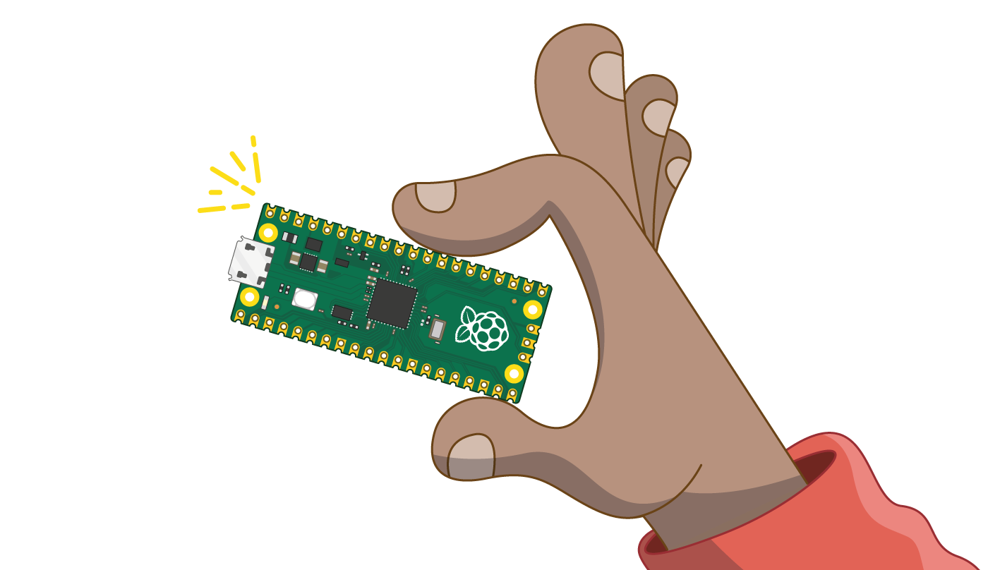
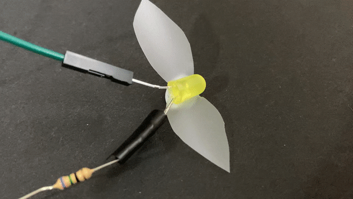
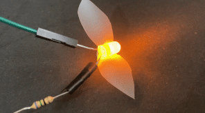
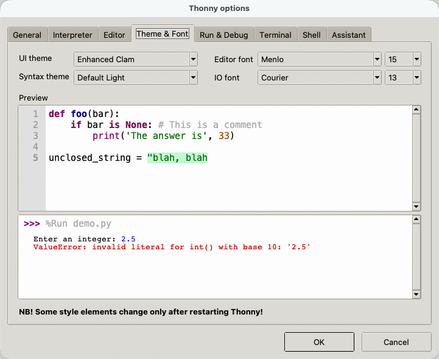

## Lo que harás

En este proyecto, usarás una Raspberry Pi Pico para crear una luciérnaga LED que parpadee siguiendo un patrón específico, como las luciérnagas en la naturaleza, y conectarás un interruptor para controlar la luz.

[[[flashing-light-warning]]]

Un microcontrolador es un dispositivo de cómputo muy pequeño que puede ejecutar código e interactuar con  componentes electrónicos (como botones y luces). Por lo general, está diseñado para realizar una sola tarea y no tiene un sistema operativo. 
La Raspberry Pi Pico es un microcontrolador de bajo costo que pueden usar tanto principiantes como personas expertas para desarrollar productos electrónicos.

{:width="300px"}

 
Vas a:

+ Conocer el **microcontrolador** Raspberry Pi Pico
+ Conectar un LED y un interruptor hecho con cables puente a los pines de una **Raspberry Pi Pico**
+ Programar la Raspberry Pi Pico con **MicroPython** y Thonny

--- no-print ---

--- task ---

¡Este ejemplo muestra un LED que parpadea para imitar a una luciérnaga real! ¿Puedes identificar el patrón que se repite en los destellos?

{:width="300px"}

--- /task ---

--- /no-print ---

--- print-only ---

--- task ---

Este ejemplo muestra una luciérnaga LED. ¡Tu LED parpadeará para imitar a una luciérnaga real!

--- /task ---

--- /print-only ---

Para completar este proyecto necesitarás:

**Hardware**

Puedes comprar todos los componentes físicos necesarios para este proyecto y los demás proyectos de esta ruta de aprendizaje en la [tienda en línea de Kitronik.](https://kitronik.co.uk/products/5343-raspberry-pi-foundation-pico-pathway-pack){:target='_blank'}

+ Una Raspberry Pi Pico con tiras de pines soldadas
+ Un cable USB A a micro USB de **datos**
+ 1× LED amarillo (o del color que prefieras)
+ 1× resistencia de 100Ω (cualquier resistencia de 75Ω a 220Ω servirá)
+ 1× cable puente pin–receptáculo
+ 3× cables puente receptáculo–receptáculo
+ Opcional: Cinta adhesiva, de preferencia cinta invisible

[[[pin-socket-jumper-wires]]]

Puedes [preparar tu LED](https://projects.raspberrypi.org/es-LA/projects/introduction-to-the-pico){:target="_blank"} con anticipación conectándolo a una resistencia y a cables puente antes de comenzar el proyecto.

**Programas**

+ Thonny – puedes completar este proyecto con el editor de Python Thonny, que se puede instalar en una computadora con Linux, Windows o Mac

Visita [thonny.org](https://thonny.org/){:target="_blank"} y elige la descarga estable más reciente para tu sistema operativo. En macOS, elige el instalador que corresponda al procesador de tu Mac: Apple Silicon (M1, M2 y posteriores) o Intel. En Linux, sigue las instrucciones de instalación del sitio web.

Ejecuta el instalador y abre Thonny. Si ya tienes Thonny, puedes instalar la versión más reciente para actualizarlo.

En Raspberry Pi OS, es posible que Thonny ya esté instalado. Usa el actualizador de software del sistema para actualizarlo; la versión que proporciona tu sistema operativo puede ser diferente de la versión más reciente del sitio web.

--- collapse ---
---
title: Haz que el texto sea más fácil de leer
---

Elige **Herramientas** > **Opciones…** y luego selecciona **Tema & Fuente**. Ajusta las fuentes del editor y de la consola, sus tamaños o los colores según tus preferencias. La vista previa muestra cómo se verán las opciones que elegiste.

Haz clic en **Aceptar** cuando termines. Algunos cambios de estilo se aplican después de reiniciar Thonny.

--- /collapse ---

