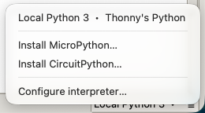
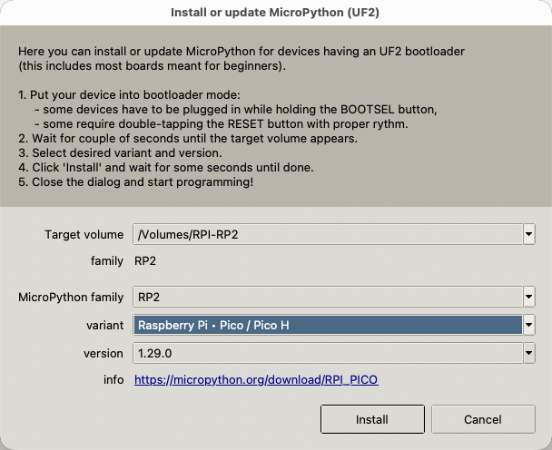
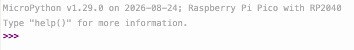
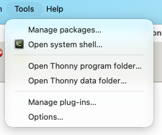
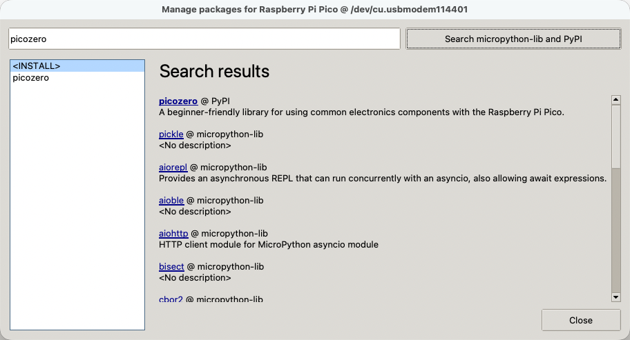
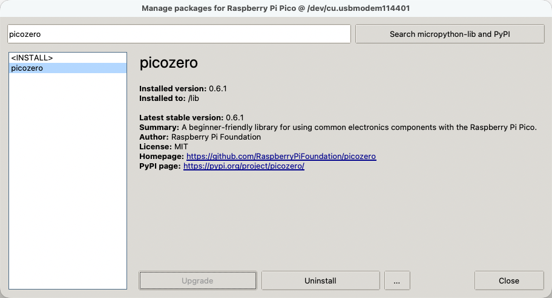
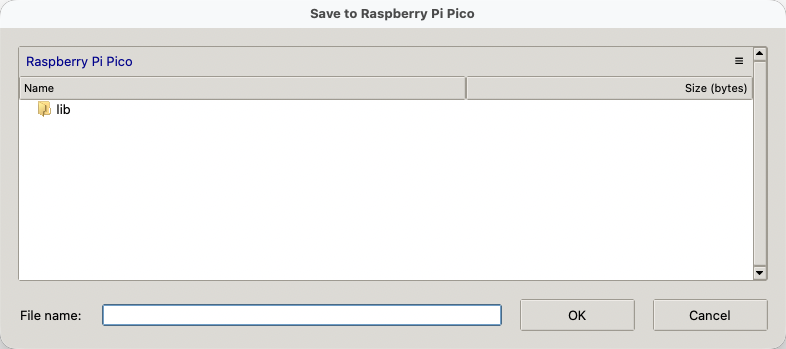

## Configura tu Raspberry Pi Pico

Conecta tu Raspberry Pi Pico y configura MicroPython.

MicroPython es una versión del lenguaje de programación Python para microcontroladores, como tu Raspberry Pi Pico. MicroPython te permite usar tus conocimientos de Python para escribir código e interactuar con componentes electrónicos.

--- task ---

Conecta el extremo pequeño de tu cable USB de datos a la Raspberry Pi Pico y luego abre Thonny en tu computadora.

--- /task ---

Las capturas de pantalla muestran Thonny 5 en macOS. Tu ventana puede verse un poco diferente en otro sistema operativo.

Si tu Pico ya ejecuta MicroPython y Thonny muestra el indicador `>>>` al conectarse a ella, omite la instalación del firmware y continúa con las instrucciones de `picozero` que aparecen más abajo.

--- task ---

Para instalar MicroPython, desconecta la Raspberry Pi Pico de tu computadora. Mantén presionado el botón **BOOTSEL** de la Pico mientras vuelves a conectarla con un cable USB de **datos** y luego suelta el botón.

La Pico aparece como una unidad extraíble. En una Raspberry Pi Pico o Pico W, esta unidad se llama **RPI-RP2**.

--- /task ---

--- task ---

En Thonny, haz clic en el selector de intérprete en la esquina inferior derecha de la ventana y luego elige **Instalar MicroPython…**.

Si no aparece la opción **Instalar MicroPython…**, comprueba que la Pico esté conectada en modo BOOTSEL y que tu computadora detecte su unidad extraíble.

--- /task ---

--- task ---

En la ventana **Instalar o actualizar MicroPython (UF2)**:

+ Selecciona la unidad de la Pico en **Volumen de destino**.
+ Selecciona **RP2** en **Familia de MicroPython**.
+ Elige la **variante** que coincida con el modelo impreso en tu placa. Por ejemplo, elige **Raspberry Pi · Pico / Pico H** para una Pico original o **Raspberry Pi · Pico W / Pico WH** para una Pico W.
+ Selecciona la **versión** estable más reciente que tenga un número de versión. Evita las versiones preliminares para este proyecto.

Haz clic en **Instalar** y espera a que termine la instalación. Mantén la Pico conectada mientras se escribe el firmware.

--- /task ---

--- task ---

Cierra el instalador cuando termine. La unidad extraíble de la Pico desaparece cuando esta se reinicia con MicroPython.

Vuelve a hacer clic en el selector de intérprete y elige la opción **MicroPython (Raspberry Pi Pico)** correspondiente a la placa que conectaste. El nombre del puerto depende de tu computadora.

Si la placa aún no aparece en la lista, desconéctala y vuelve a conectarla **sin mantener presionado BOOTSEL**. Luego, inténtalo de nuevo. Si necesitas volver a conectarte, haz clic en el botón rojo **Detener/Reiniciar backend**.

La consola debería mostrar un mensaje de MicroPython y el indicador `>>>`.

--- /task ---

--- task ---

**Depurar:**

--- collapse ---
---
title: La unidad de la Pico no aparece
---

Desconecta la Pico y luego mantén presionado **BOOTSEL** mientras vuelves a conectarla. Suelta el botón después de conectarla.

Usa un cable USB que pueda transferir datos. Un cable que solo sirve para cargar suministrará energía a la Pico, pero no permitirá que tu computadora se comunique con ella. Prueba con otro cable de datos o puerto USB.

Si macOS solicita permiso para que Thonny acceda a los volúmenes extraíbles, permite el acceso para que pueda encontrar la unidad de la Pico.

--- /collapse ---

--- collapse ---
---
title: La instalación del firmware falla
---

Comprueba tu conexión a internet: Thonny descarga la lista de versiones de firmware disponibles y el firmware seleccionado.

Comprueba que el volumen de destino seleccionado corresponda a tu Pico y que la variante coincida con tu placa. Vuelve a conectar la Pico mientras mantienes presionado **BOOTSEL** y luego intenta instalar el firmware de nuevo.

--- /collapse ---

--- collapse ---
---
title: El firmware está instalado, pero Thonny no puede conectarse
---

Vuelve a conectar la Pico **sin mantener presionado BOOTSEL**. Elige la opción **MicroPython (Raspberry Pi Pico)** correspondiente a tu placa en el selector de intérprete de Thonny y luego haz clic en **Detener/Reiniciar backend**.

Si es necesario, elige **Ejecutar** > **Configurar intérprete…**, selecciona **MicroPython (Raspberry Pi Pico)** y comprueba el puerto de la placa que conectaste. Cierra cualquier otro programa que pueda estar usando ese puerto.

Revisa tu cable USB de datos y prueba con otro puerto USB antes de reinstalar el firmware.

--- /collapse ---

--- /task ---

`picozero` es una biblioteca de MicroPython para quienes están empezando a usar la Raspberry Pi Pico.

--- task ---

Comprueba que Thonny esté conectado a tu Pico: el selector de intérprete de la esquina inferior derecha debería mostrar **MicroPython (Raspberry Pi Pico)**.

Elige **Herramientas** > **Administrar paquetes…**. El título de la ventana debería decir **Administrar paquetes para Raspberry Pi Pico**, para que la biblioteca se instale en tu placa.

--- /task ---

--- task ---

Escribe `picozero` en el cuadro de búsqueda y haz clic en **Buscar en micropython-lib y PyPI**.

--- /task ---

--- task ---

Selecciona **picozero @ PyPI** en los resultados de búsqueda y luego haz clic en **Instalar**. Si ya hay una versión anterior instalada, haz clic en **Actualizar**. Si la versión instalada coincide con la versión estable más reciente, puedes continuar.

Espera a que termine la instalación. La información del paquete mostrará la versión instalada y su ubicación en la Pico, `/lib`.

Cierra el gestor de paquetes y luego haz clic en el botón rojo **Detener/Reiniciar backend** de Thonny antes de ejecutar tu código.

--- /task ---

Si tienes dificultades para instalar la biblioteca `picozero` en Thonny, puedes descargar el archivo de la biblioteca y guardarlo en tu Raspberry Pi Pico.

--- collapse ---
---
title: Instala picozero sin el gestor de paquetes
---

En una computadora con acceso a internet, abre el [archivo de la biblioteca picozero](https://raw.githubusercontent.com/RaspberryPiFoundation/picozero/master/picozero/picozero.py){:target="_blank"} y guárdalo como `picozero.py`. Si es necesario, transfiere el archivo a la computadora que usas para programar mediante una memoria USB.

Conecta la Pico y selecciona su intérprete **MicroPython (Raspberry Pi Pico)** en Thonny.

Elige **Archivo** > **Abrir…**, luego **Esta computadora**, y abre el archivo `picozero.py` que descargaste. Elige **Archivo** > **Guardar como…** y luego **Raspberry Pi Pico**. En la carpeta principal de la Pico, escribe `picozero.py` en **Nombre de archivo** y haz clic en **Aceptar**.

Haz clic en **Detener/Reiniciar backend** antes de ejecutar el código de tu proyecto. Guarda tu propio proyecto en un archivo aparte, como `firefly.py` o `pico_led.py`.

--- /collapse ---
