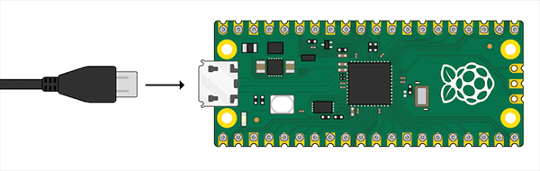
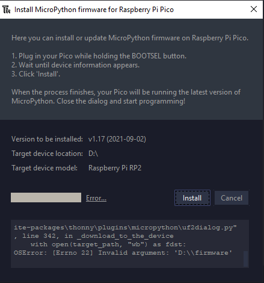
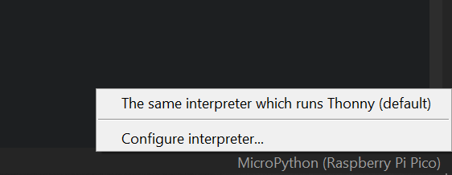
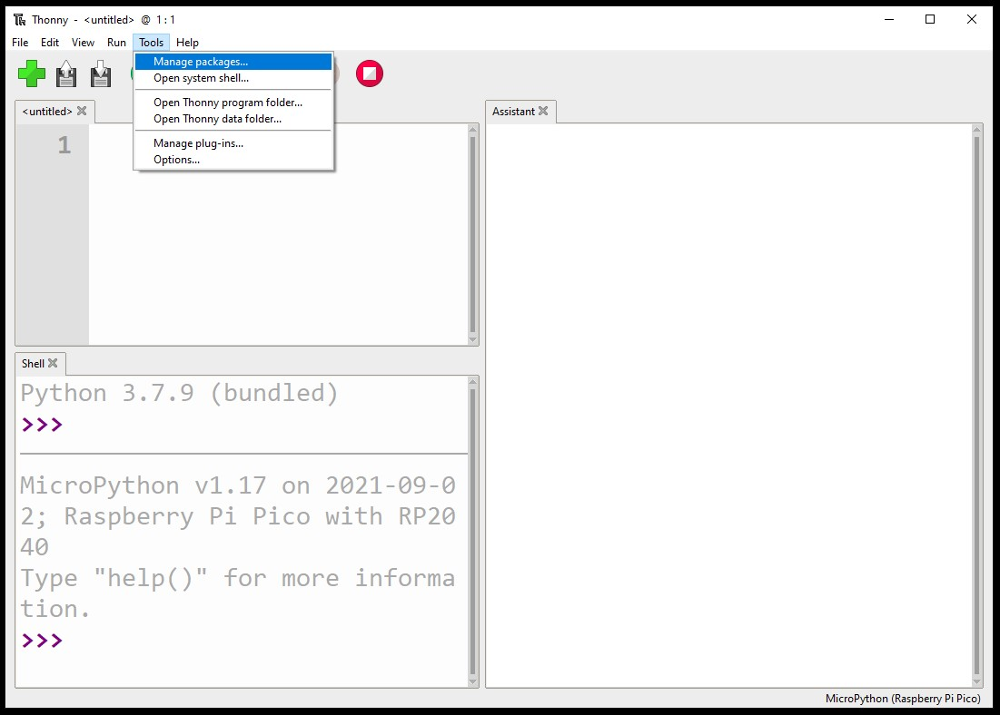
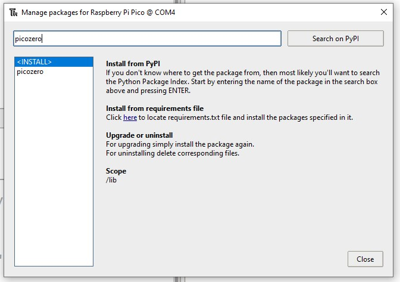
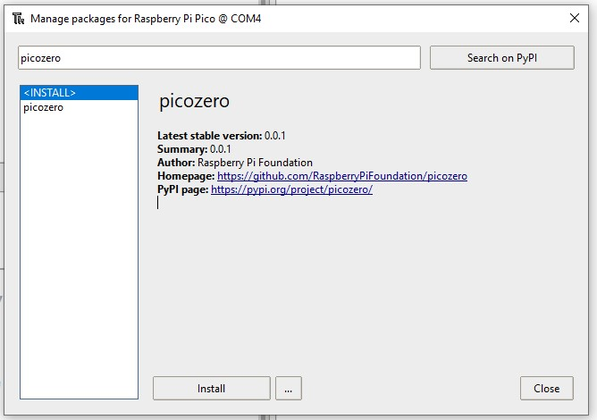

## Configura tu Raspberry Pi Pico

Conecta tu Raspberry Pi Pico y configura MicroPython.

MicroPython es una versión del lenguaje de programación Python para microcontroladores, como tu Raspberry Pi Pico. MicroPython te permite usar tus conocimientos de Python para escribir código e interactuar con componentes electrónicos.

--- task ---

**Conecta** el extremo pequeño de tu cable USB a la Raspberry Pi Pico.

--- /task ---

--- task ---

**Conecta** el otro extremo a tu computadora, laptop o Raspberry Pi.

--- /task ---

--- task ---

Abre el editor Thonny.

--- /task ---

--- task ---

Observa el texto en la esquina inferior derecha del editor Thonny. Te mostrará la versión de Python que se está usando.

Si no dice "MicroPython (Raspberry Pi Pico)", haz clic en el texto y selecciona "MicroPython (Raspberry Pi Pico)".

Si nunca has usado MicroPython en tu Raspberry Pi Pico, Thonny te pedirá que agregues el firmware de MicroPython. Haz clic en **Instalar MicroPython**.

--- /task ---

--- task ---

**Depurar:**

--- collapse ---
---
title: Hubo un error al instalar el firmware
---

Si ves un mensaje de error durante la instalación:
+ Desconecta tu Raspberry Pi Pico
+ Vuelve a conectar tu Raspberry Pi Pico
+ Intenta instalar el firmware de nuevo (quizás debas presionar primero el botón de detener)

--- /collapse ---

--- collapse ---
---
title: No sé si el firmware está instalado y no puedo conectarme a mi Pico
---

Asegúrate de que tu Raspberry Pi Pico esté conectada a tu computadora con un cable micro USB. Haz clic en la lista de la esquina inferior derecha de la ventana de Thonny. Aparecerá un menú emergente con los intérpretes disponibles.

Si no ves la Pico en la lista (como en la imagen), tendrás que volver a conectar tu Raspberry Pi Pico mientras mantienes presionado el botón BOOTSEL para que aparezca como una unidad de almacenamiento, y reinstalar el firmware siguiendo las instrucciones de la sección anterior.

--- /collapse ---

--- collapse ---
---
title: El firmware está instalado, pero aún no puedo conectarme a mi Pico
---

Puede que estés usando un tipo de cable micro USB incorrecto. Tu cable micro USB actual puede estar dañado o estar diseñado solo para suministrar energía a los dispositivos, sin poder transferir datos. Prueba con otro cable si nada más ha funcionado.

Si tu Pico sigue sin conectarse después de probar todo esto, es posible que la **propia Pico** esté dañada y no pueda conectarse.

--- /collapse ---

Puedes encontrar más información en la [Guía de Raspberry Pi Pico](https://projects.raspberrypi.org/es-LA/projects/introduction-to-the-pico){:target="_blank"}.

--- /task ---

`picozero` es una biblioteca de MicroPython para quienes están empezando a usar la Raspberry Pi Pico.

--- task ---

Para completar los proyectos de esta ruta de aprendizaje, tendrás que instalar la biblioteca `picozero` como un paquete de Thonny.

En Thonny, selecciona **Herramientas** > **Administrar paquetes**.

--- /task ---

--- task ---

En la ventana emergente 'Administrar paquetes para Raspberry Pi Pico', escribe `picozero` y haz clic en **Buscar en PyPi**.

--- /task ---

--- task ---

Haz clic en **picozero** en los resultados de búsqueda.

Haz clic en **Instalar**.

Cuando termine la instalación, cierra la ventana de paquetes y luego cierra y vuelve a abrir Thonny.

--- /task ---

Si tienes dificultades para instalar la biblioteca `picozero` en Thonny, puedes descargar el archivo de la biblioteca y guardarlo en tu Raspberry Pi Pico.

[[[picozero-offline-install]]]
