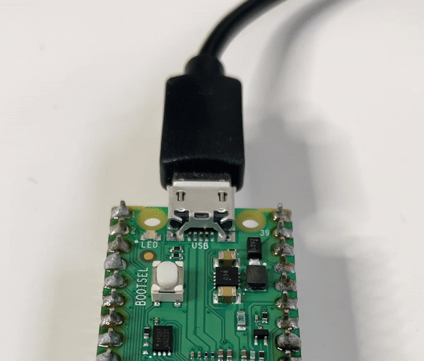
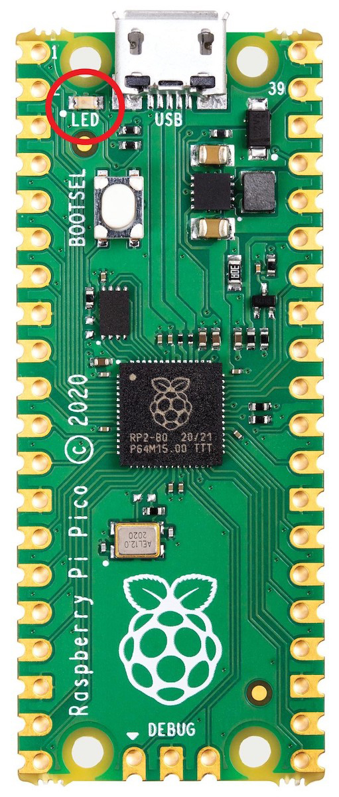
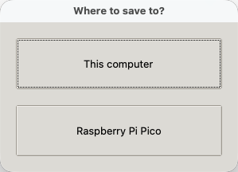
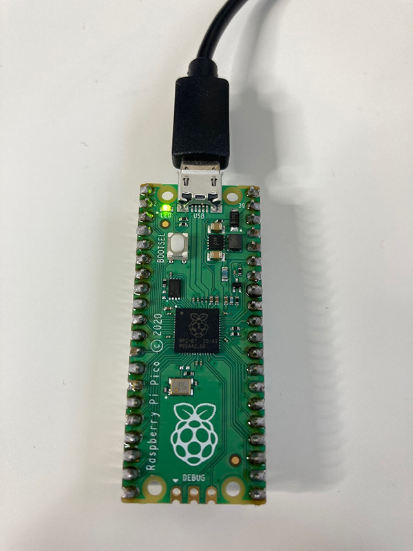

## Enciende el LED de la Raspberry Pi Pico

En este paso, encenderás el pequeño LED que está en la parte superior de tu Raspberry Pi Pico. Esto te permitirá comprobar que tu Raspberry Pi Pico está configurada correctamente.

{:width="300px"}

LED es la sigla en inglés de diodo emisor de luz. Utiliza la electroluminiscencia, que ocurre cuando un material se ilumina al pasar una corriente eléctrica a través de él. Un LED tiene dos patitas — una larga y una corta — y debe conectarse en la orientación correcta. La patita larga es positiva (+) y la corta es negativa (-). Otra forma de comprobar si una patita es positiva o negativa es buscar con el dedo el lado plano del LED. El lado plano está del mismo lado que la patita negativa.

--- task ---

Observa tu Raspberry Pi Pico y busca el pequeño LED que está junto al conector USB.

{:width="200px"}

--- /task ---

--- task ---

Crea un archivo nuevo en Thonny haciendo clic en **Archivo** > **Nuevo** en la barra de menú superior. Se abrirá un espacio de trabajo vacío.

--- /task ---

En el paso anterior, instalaste la biblioteca `picozero`. Esta biblioteca te permite programar componentes electrónicos conectados a una Raspberry Pi Pico. Al principio de tu código, tendrás que importar los elementos que necesitas de la biblioteca `picozero`.

--- task ---

Escribe el siguiente código en el panel principal del editor de Thonny:

--- code ---
---
language: python filename: line_numbers: true line_number_start:
line_highlights:
---
from picozero import pico_led

pico_led.on()

--- /code ---

--- /task ---

--- task ---

Elige **Archivo**->**Guardar como**. Thonny te preguntará si quieres guardar el archivo en **Esta computadora** o en la **Raspberry Pi Pico**. Elige **Esta computadora** para guardar el código en tu computadora.

Elige una ubicación en tu computadora, como la carpeta 'Documentos'. Nombra tu archivo `firefly.py`.

--- /task ---

--- task ---

**Prueba:** Thonny tiene un botón verde de ejecución con un pequeño triángulo blanco dentro. Presionar este botón te permite ejecutar tu código.

+ Presiona el botón de ejecución

+ Comprueba que el pequeño LED de la Raspberry Pi Pico se encienda

{:width="300px"}

--- /task ---

--- task ---

**Depurar:**

--- collapse ---
---
title: El botón de ejecución está atenuado
---

Si no ves el botón verde de ejecución (está atenuado):
+ Haz clic en el botón rojo **DETENER**
+ Comprueba que tu Raspberry Pi Pico esté conectada a tu computadora con un cable USB
+ Haz clic en **MicroPython (Raspberry Pi Pico)** en la esquina inferior derecha de Thonny para volver a conectarla
+ Desconecta el cable USB y luego vuelve a conectarlo

--- /collapse ---

--- collapse ---
---
title: Thonny dice que hay un error en mi código
---

Revisa tu código con mucho cuidado y asegúrate de que coincida con el ejemplo.

--- /collapse ---

--- collapse ---
---
title: No hay errores en mi código, pero la luz no se enciende
---

Prueba con otro cable USB y asegúrate de que sea un cable USB de **datos**. Como último recurso, prueba con otra Raspberry Pi Pico (si tienes una de repuesto).

--- /collapse ---

--- /task ---

El LED permanecerá encendido hasta que escribas código para apagarlo o desconectes la Raspberry Pi Pico.

--- task ---

Importa `sleep` para poder pausar tu código. Agrega código al final de tu programa para hacer una pausa de un segundo y luego apagar el LED.

--- code ---
---
language: python filename: firefly.py line_numbers: true line_number_start: 1
line_highlights: 2,5-6
---
from picozero import pico_led from time import sleep

pico_led.on() sleep(1) pico_led.off()
--- /code ---

--- /task ---

--- task ---

**Prueba:** Haz clic en el botón verde de **ejecución**. Thonny guardará el archivo en tu Raspberry Pi Pico y luego ejecutará el código nuevo.

Comprueba que el LED se encienda y luego se apague. El LED solo se encenderá durante un segundo, así que asegúrate de estar mirando.

Ejecuta tu código tantas veces como quieras.

{:width="300px"}

**Depurar:**

--- collapse ---
---
title: Thonny dice que sleep no está definido
---

Agrega la línea `from time import sleep`.

--- /collapse ---

--- /task ---
