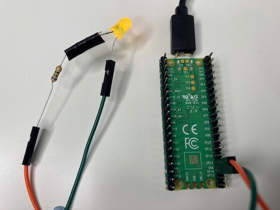
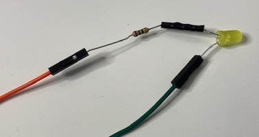
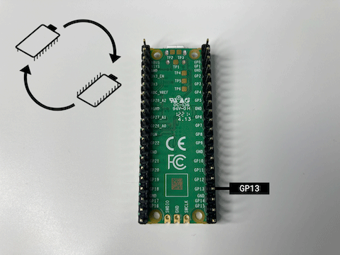
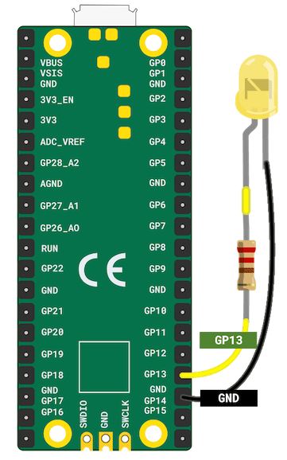
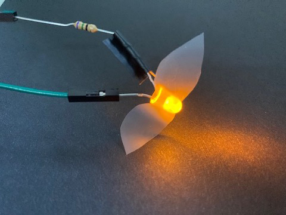

## Enciende tu luciérnaga

En este paso, usarás cables puente para conectar un LED con una resistencia a tu Raspberry Pi Pico y escribirás código para encenderlo. 

{:width="300px"}

--- task ---

Asegúrate de tener un LED conectado a una resistencia y dos cables puente receptáculo–receptáculo. El color de los cables puente no importa, todos hacen lo mismo.

Las luciérnagas suelen ser amarillas, naranjas o verdes, pero puedes elegir el color que quieras.

Una **resistencia** controla la corriente que pasa por un circuito. Esto evita que el LED se queme y hace que dure más.

Si tu LED no tiene cables puente ni una resistencia conectados, puedes agregarlos:

[[[led-resistor-electrical-tape]]]

[[[led-resistor-solder-heat-shrink]]]

--- /task ---

Una Raspberry Pi Pico tiene **40 pines** en su placa. Los **pines** te permiten conectar componentes externos a la Raspberry Pi Pico.

--- task ---

Explora tu Raspberry Pi Pico y busca el pin que tiene la etiqueta **GP13**. Verás que hay etiquetas para cada pin en la parte **inferior** de la Raspberry Pi Pico.

--- /task ---

--- task ---

**Conecta** el cable puente unido a la pata positiva del LED (la que tiene la resistencia) al pin **GP13**. Empújalo hasta que el plástico negro toque la base de la hilera de pines.

**Conecta** el cable puente unido a la pata negativa al pin **GND** (tierra), debajo de **GP13**. Esto completa el circuito y permite que la corriente eléctrica fluya cuando tu código lo indique.

--- /task ---

--- task ---

En el paso anterior, usaste `pico_led` para encender el LED de la Raspberry Pi Pico. Para agregar tus propios LED, necesitas usar `import` para importar `LED` de `picozero`.

Agrega `, LED` al final de la lista de importación en la **línea 1**. Luego, configura el LED de tu luciérnaga para usar **GP13** e ingresa el código para encenderlo.

Ingresa el código para encender tu luciérnaga:

--- code ---
---
language: python filename: firefly.py line_numbers: true line_number_start: 1
line_highlights: 1,8-9
---
from picozero import pico_led, LED from time import sleep

pico_led.on() sleep(1) pico_led.off()

firefly = LED(13) # Use GP13 firefly.on() --- /code ---

**Consejo:** Para importar varios elementos, sepáralos con comas `,`.

--- /task ---

--- task ---

**Prueba:** Ejecuta tu código para ver cómo se enciende tu luciérnaga LED.

**Depurar**:

--- collapse ---
---
title: Mi código no se ejecuta
---

Si tu código no se ejecuta:
+ Corrige los errores en tu código. El LED de la Raspberry Pi Pico parpadeará si tu código se ejecuta correctamente.

--- /collapse ---

--- collapse ---
---
title: Mi luciérnaga LED no se enciende
---

Si tu luciérnaga LED no se enciende:
+ Revisa que tu LED tenga el lado negativo (con la pata más corta y el borde plano) conectado a **GND** y el lado positivo (con la pata más larga y la resistencia) conectado a **GP13**
+ Asegúrate de que todas las uniones hagan buen contacto
+ Prueba con otro LED

--- /collapse ---

--- /task ---

--- task ---

**Opcional:** Recorta unas alas de cinta adhesiva doblada sobre sí misma y pégalas a tu LED. La cinta adhesiva transparente funciona bien.

--- /task ---
