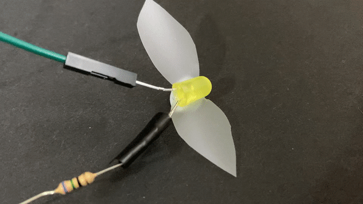

## Haz que tu luciérnaga parpadee

Ahora harás que tu luciérnaga se encienda y se apague, como una luciérnaga real. 

{:width="300px"}

Una luciérnaga es un tipo de escarabajo, también conocido como gusano de luz o bichito de luz. Las luciérnagas usan la bioluminiscencia para emitir destellos y darse a conocer a otros miembros de su misma especie. Cada especie emite destellos con patrones diferentes. 

--- task ---

Modifica tu código para que la luciérnaga se encienda y se apague en un bucle `while True:`. Los tiempos representan los patrones de luz de una luciérnaga real.

Asegúrate de que el código de las líneas 11–14 tenga sangría.

**Consejo:** En Thonny puedes agregar sangría al código colocando el cursor al inicio de la línea y presionando la tecla <kbd>Tab</kbd> — esto insertará cuatro espacios. Thonny agregará sangría automáticamente según la línea anterior cuando presiones <kbd>Enter</kbd> mientras escribes.

--- code ---
---
language: python filename: firefly.py line_numbers: true line_number_start: 8
line_highlights: 9-14
---
firefly = LED(13) # Use GP13

while True: firefly.on() sleep(0.5) firefly.off() sleep(2.5)
--- /code ---

--- /task ---

--- task ---

**Prueba:** Ejecuta tu código para ver cómo la luciérnaga se enciende y se apaga lentamente.

**Depurar:**

+ Corrige cualquier error en tu código, incluidos los de sangría
+ Revisa que ninguna de las conexiones del LED de tu luciérnaga se haya aflojado

--- /task ---
