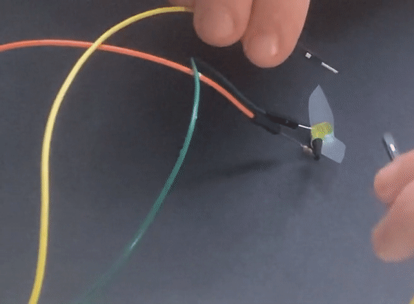
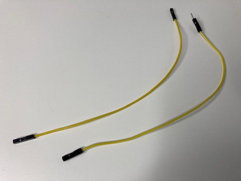
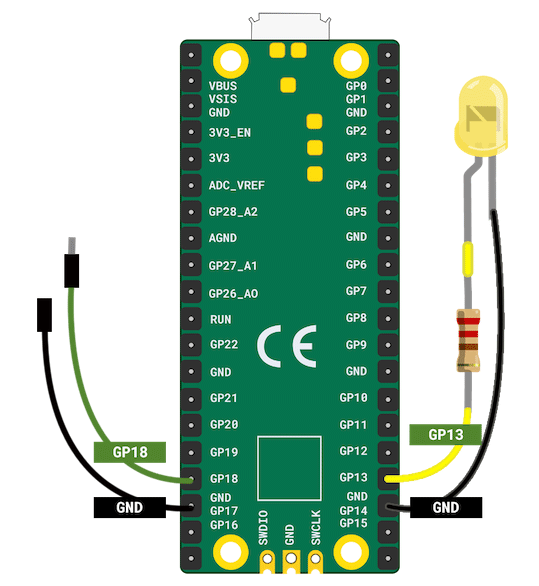
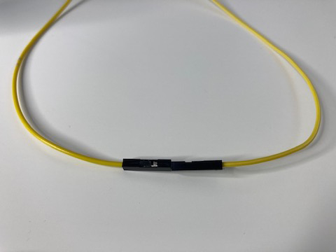

## Agrega un interruptor

Es útil poder controlar cuándo empieza a parpadear tu luciérnaga LED y poder apagarla desde el dispositivo. 

{:width="300px"}

La Raspberry Pi Pico puede detectar cuándo se conecta una entrada entre **GND** y uno de los pines GP.

Un interruptor es un componente eléctrico que se puede **cerrar** para dejar pasar la corriente eléctrica y **abrir** para impedir que pase. Un botón también es un tipo de interruptor que establece una conexión cuando se **presiona**.

El tipo de interruptor más sencillo consiste en dos cables puente que se pueden conectar entre sí para cerrar el interruptor, o separar para abrirlo.

[[[pin-socket-jumper-wires]]]

--- task ---

Busca un cable puente pin–receptáculo y uno receptáculo–receptáculo — los colores no importan.

--- /task ---

--- task ---

**Conecta** un cable puente a **GP18** y el otro a **GND**. No importa qué cable puente conectes a cada pin.

--- /task ---

--- task ---

Para agregar interruptores, necesitas importar `import Switch` de la biblioteca `picozero`.

Agrega `, Switch` al final de la lista de importación en la **línea 1**. Luego, configura tu `switch` en **GP18**:

--- code ---
---
language: python filename: firefly.py line_numbers: true line_number_start: 1
line_highlights: 1, 9
---
from picozero import pico_led, LED, Switch from time import sleep

pico_led.on() sleep(1) pico_led.off()

firefly = LED(13) # Use GP13 switch = Switch(18) # Use GP18

--- /code ---

--- /task ---

Cuando conectas los dos cables puente entre sí, se completa un circuito y la Raspberry Pi Pico puede detectar que el interruptor está cerrado.

--- task ---

Agrega código para comprobar con `if` si tu interruptor está cerrado (`is_closed`, los cables puente están conectados) y hacer que la luciérnaga parpadee solo si está cerrado:

--- code ---
---
language: python filename: firefly.py line_numbers: true line_number_start: 9
line_highlights: 12-19
---
switch = Switch(18) # Use GP18

while True: if switch.is_closed: # Wires are connected firefly.on() sleep(0.5) # Stay on for half a second firefly.off() sleep(2.5) # Stay off for 2.5 seconds else: # Wires are not connected firefly.off() sleep(0.1) # Small delay

--- /code ---

--- /task ---

--- no-print ---

--- task ---

**Prueba:** Asegúrate de que los cables puente **no** estén conectados entre sí, luego ejecuta tu código.

--- collapse ---

---
title: ¿Qué esperas que pase cuando ejecutes tu código?
---

Los cables puente **no** cierran el circuito, así que se ejecutará el código del bloque `else`. Esto significa que el LED de la luciérnaga permanecerá **apagado**.

--- /collapse ---

Ahora conecta los cables puente entre sí. La luciérnaga debería empezar a parpadear.

Desconecta los cables puente y la luciérnaga debería dejar de parpadear.

--- /task ---

--- /no-print ---

--- print-only ---

--- task ---

**Prueba:** Asegúrate de que los cables puente **no** estén conectados entre sí, luego ejecuta tu código.

--- collapse ---

---
title: ¿Qué esperas que pase cuando ejecutes tu código?
---

Los cables puente **no** cierran el circuito, así que se ejecutará el código del bloque `else`. Esto significa que el LED de la luciérnaga permanecerá **apagado**.

--- /collapse ---

Ahora conecta los cables puente entre sí.

La luciérnaga debería empezar a parpadear.

Desconecta los cables puente y la luciérnaga debería dejar de parpadear.

--- /task ---

--- /print-only ---

**Nota:** Desconectar los cables puente no cortará de inmediato la alimentación del LED de la luciérnaga. La luciérnaga solo se apaga cuando se ejecuta el código `firefly.off()`.

--- task ---

**Opcional:** Si estás en un grupo, pueden intentar sincronizar sus luciérnagas conectando sus interruptores de cables puente al mismo tiempo.

--- /task ---
