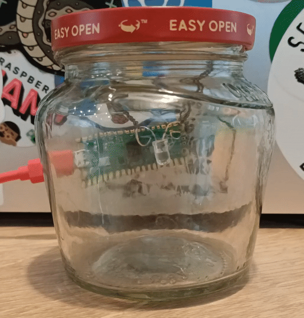

## Mejora tu proyecto

Si tienes tiempo, mejora tu proyecto de luciérnaga. Podrías usar tu proyecto para decorar tu habitación y recordar la naturaleza cuando estés dentro de casa. 

{:width="300px"}

Estar en la naturaleza es una excelente manera de sentirte mejor y cuidar tu salud. Cuando no puedas salir al aire libre, puedes buscar formas de acercar la naturaleza a ti; por ejemplo, ¡con una planta de interior o simulando tu propia luciérnaga!

--- task ---

Podrías mejorar tu proyecto de estas formas:
+ Agregar otra luciérnaga LED y hacer que parpadee con el mismo patrón.
+ Cambiar el patrón de parpadeo — podrías investigar los patrones de parpadeo de las luciérnagas en la naturaleza.
+ Coloca tu luciérnaga LED en un frasco. Incluso podrías usar hilo conductor para colgar un LED de la tapa.

--- /task ---

Los dispositivos integrados suelen contener un microcontrolador y están diseñados para una tarea específica. Quizás hayas usado uno en un control de videojuegos, un horno de microondas, una luz ambiental, un juego o juguete electrónico, un contador de pasos, un asistente para el hogar controlado por voz, un dispositivo médico o una calculadora electrónica. ¿Qué dispositivos integrados usas?

--- collapse ---
---
title: Proyecto terminado
---

Puedes ver el [proyecto completo aquí](https://rpf.io/p/es-LA/led-firefly-get){:target="_blank"}.

--- /collapse ---
