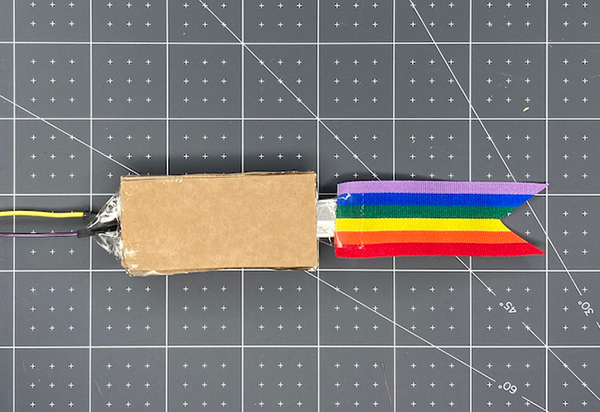
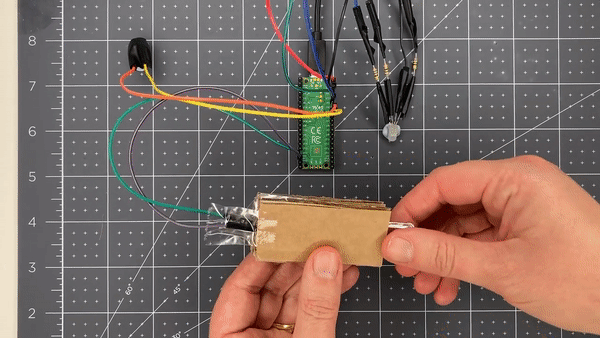

## ¿Qué sigue?

Si estás siguiendo la ruta [Introducción a la Raspberry Pi Pico](https://projects.raspberrypi.org/es-LA/pathways/pico-intro), puedes pasar al proyecto [Petardo de fiesta](https://projects.raspberrypi.org/es-LA/projects/party-popper). En este proyecto, crearás un petardo de fiesta reutilizable que te recompensará con un espectáculo de luces y sonidos al tirar de él.

--- print-only ---

--- /print-only ---

--- no-print ---

--- /no-print ---

***
Este proyecto fue traducido por voluntarios:

[name]

[name]

[name]

Gracias a los voluntarios, podemos dar a las personas de todo el mundo la oportunidad de aprender en su propio idioma. Puedes ayudarnos a llegar a más personas ofreciéndote como voluntario para traducir. Más información en [rpf.io/translate](https://rpf.io/translate).
